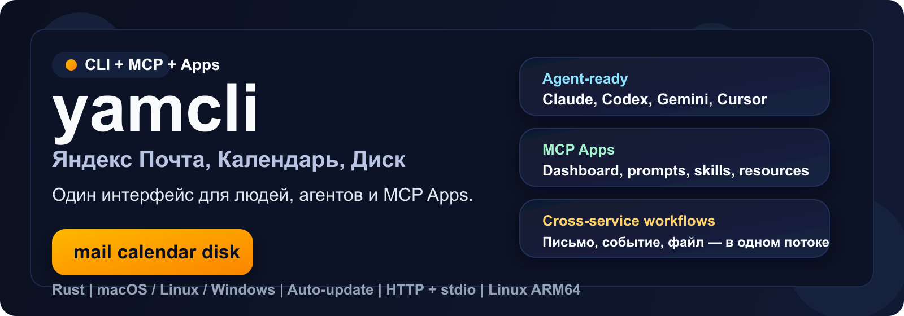
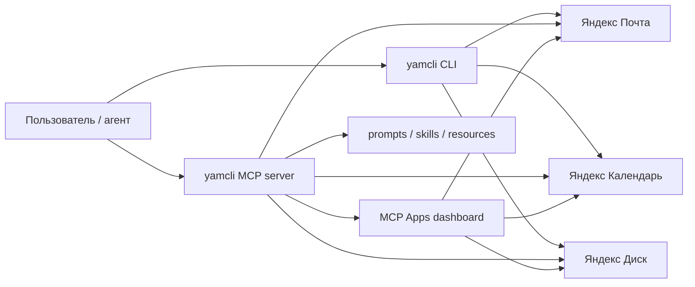

<p align="center">
  
</p>

<h1 align="center">yamcli</h1>

<p align="center"><strong>CLI, MCP server и MCP Apps для Яндекс Почты, Календаря и Диска</strong></p>

<p align="center">Один аккуратный продуктовый интерфейс для терминала, ИИ-агентов и MCP-хостов.</p>

<p align="center">
  <a href="https://github.com/aikalinin/mcp-local-ya/releases"></a>
  <a href="https://github.com/aikalinin/mcp-local-ya/actions/workflows/ci.yml"></a>
  
  
  
  <a href="https://github.com/aikalinin/mcp-local-ya/blob/main/LICENSE"></a>
</p>

<p align="center">
  <a href="#установка"><strong>Установка</strong></a> •
  <a href="#быстрый-старт"><strong>Быстрый старт</strong></a> •
  <a href="#повседневные-команды"><strong>Команды</strong></a> •
  <a href="#кросс-сервисные-сценарии"><strong>Сценарии</strong></a> •
  <a href="#mcp"><strong>MCP</strong></a>
</p>

`yamcli` связывает Яндекс Почту, Календарь и Диск в один внятный интерфейс: в терминале, в агентских клиентах и внутри MCP Apps. Один бинарь закрывает повседневную ручную работу, агентские интеграции и составные сценарии вроде `письмо → .ics → событие` или `файл → письмо`.

<table>
  <tr>
    <td width="33%" valign="top">
      <strong>CLI для ежедневной работы</strong><br/><br/>
      Почта, календарь, вложения, события и приватный Диск в одном бинаре и одном конфиге.
    </td>
    <td width="33%" valign="top">
      <strong>MCP для агентов</strong><br/><br/>
      Полноценный MCP-сервер с <code>stdio</code>, <code>http</code>, prompts, skills, resources, completions, roots и write-tools.
    </td>
    <td width="33%" valign="top">
      <strong>MCP Apps для UI-хостов</strong><br/><br/>
      Дашборд, deep links, prompts, браузер ресурсов и живые кросс-сервисные сценарии.
    </td>
  </tr>
</table>

<table>
  <tr>
    <td width="33%" valign="top">
      <strong>Письмо → вложение → файл</strong><br/><br/>
      Найти письмо, выгрузить нужное вложение и сохранить его локально без промежуточных скриптов.
    </td>
    <td width="33%" valign="top">
      <strong>Письмо → <code>.ics</code> → событие</strong><br/><br/>
      Разобрать приглашение из письма и сразу создать встречу в нужном календаре.
    </td>
    <td width="33%" valign="top">
      <strong>Файл → письмо</strong><br/><br/>
      Взять локальный файл, приложить его к письму и отправить через тот же интерфейс.
    </td>
  </tr>
</table>

<!--
TODO: добавить GIF / скриншот терминала с yamcli mail list + yamcli status
-->

## Установка

### macOS и Linux

```bash
curl -fsSL https://raw.githubusercontent.com/aikalinin/mcp-local-ya/main/scripts/install.sh | sh
```

### Windows

```powershell
irm https://raw.githubusercontent.com/aikalinin/mcp-local-ya/main/scripts/install.ps1 | iex
```

Готовые сборки для macOS `x86_64`/`arm64`, Linux `x86_64`/`arm64` и Windows `x86_64` лежат в [GitHub Releases](https://github.com/aikalinin/mcp-local-ya/releases).

<details>
<summary>Из исходников / обновление / private mirror</summary>

```bash
cargo install --path .                 # сборка из исходников
yamcli update                           # обновить до последнего релиза
yamcli update --check                   # проверить без установки
```

Для private release mirror:

```bash
export YAMCLI_UPDATE_BASE_URL='https://mirror.example.test/releases/download/v1.0.0'
yamcli update --check
```

</details>

## Быстрый старт

**Запуск за минуту**

```bash
curl -fsSL https://raw.githubusercontent.com/aikalinin/mcp-local-ya/main/scripts/install.sh | sh
yamcli setup me@yandex.ru --calendar-app-password <пароль> --client claude
```

После этого у вас сразу будут:

- локальный CLI для Почты, Календаря и Диска;
- MCP server для Claude, Codex, Gemini и других клиентов;
- prompts, embedded skills, resources и dashboard для MCP Apps;
- готовые кросс-сервисные сценарии без клея из скриптов.
- live onboarding checklist в Unified Home, чтобы добить недостающие шаги без гадания.
- terminal home screen через `yamcli home`, чтобы увидеть onboarding, workflows и последние действия в одном месте.
- product health-check через `yamcli doctor` и `resource://yamcli/doctor`, чтобы быстро понять, что ещё мешает readiness.
- safe remediation через `yamcli doctor --apply-safe` и кнопку `Apply safe fixes` в Unified Home, чтобы автоматически закрыть безопасные локальные фиксы.
- ranked next actions через `yamcli next` и `resource://yamcli/next-actions`, чтобы сразу видеть самые выгодные следующие шаги.
- proactive suggestions через `yamcli suggest` и `resource://yamcli/suggestions`, чтобы получать recovery / cleanup / undo подсказки из реальной activity history и live product signals.
  В `Unified Home` эти suggestions теперь не только видны, но и ведут прямо в `undo` или канонический workflow/review path.
- `workflow show` и `resource://yamcli/workflow/{workflow}` теперь отдают server-driven `execution.state` и `execution.available_actions`, чтобы CLI, MCP и Apps видели один и тот же actionable lifecycle workflow: `needs_input`, `review_ready`, `ready`, `recovery_ready`, `undo_ready`, `applied`, `undone`.
- Workflow panel в Apps теперь использует server-driven `execution.actions` для `next action`, так что `connect / review / resume / cleanup / undo / replay` идут из одного канонического workflow contract, а не из UI-эвристик.
- Для partial recovery `execution.actions` теперь по возможности несёт точный `tool_name + tool_arguments`, чтобы Apps могли открыть или применить retry-step без ручного прыжка в activity/replay shell command.

### С чего начать

| Если вам нужно | Что делать |
| --- | --- |
| **Пройти setup одним проходом** | `yamcli setup me@yandex.ru --calendar-app-password <пароль> --client claude` |
| **Быстро подключить Почту и Диск** | `yamcli add` → `yamcli login` |
| **Подключить Календарь** | получить пароль приложения Яндекс ID → `yamcli login calendar --app-password <пароль>` |
| **Поставить MCP в Claude / Codex / Gemini** | `yamcli mcp install --client <client>` |
| **Поднять локальный HTTP MCP** | `yamcli mcp --transport http --listen 127.0.0.1:8787` |
| **Разрешить агенту файлы из папки** | `export YAMCLI_MCP_ALLOWED_PATHS="$HOME/Downloads"` (см. «Безопасность MCP») |

Для агентских и headless-сценариев `yamcli login` теперь работает в два шага без ломкого `stdin`-диалога:

```bash
yamcli login
# => status=pending, authorization_url, resume_command

yamcli login --code <код>
```

`yamcli` сохраняет pending PKCE session в локальном config dir и переиспользует её при втором вызове, поэтому код подтверждения больше не ломается из-за нового `code_verifier`.

<details>
<summary><strong>Как получить пароль приложения для Календаря</strong></summary>

1. Откройте [Пароли приложений Яндекс ID](https://yandex.ru/support/id/ru/authorization/app-passwords).
2. Перейдите `Безопасность` → `Доступ к вашим данным` → `Пароли приложений`.
3. Выберите тип `Календарь`.
4. Задайте имя, например `yamcli calendar`, и скопируйте пароль.

Если не хотите хранить пароль локально:

```bash
export YAMCLI_CALENDAR_APP_PASSWORD='<пароль>'
yamcli login calendar --env-var YAMCLI_CALENDAR_APP_PASSWORD
```

В релизных сборках OAuth-токены и пароли приложений хранятся в системном keyring/keychain. В debug/test-сборках по умолчанию используется `file` backend, чтобы локальная разработка и `cargo test` не спамили keychain prompt-ами. Для явного override: `export YAMCLI_SECRET_BACKEND=keyring` или `export YAMCLI_SECRET_BACKEND=file`.

</details>

### Проверьте, что всё работает

```bash
yamcli home
yamcli doctor
yamcli doctor --apply-safe
yamcli next
yamcli suggest
yamcli status
yamcli mail list
yamcli calendar calendars
yamcli disk info
```

## Живой сценарий в Claude Cowork

`yamcli` уже тянет реальные составные задачи внутри агентского интерфейса, а не только отдельные команды.

**Запрос в Claude Cowork:**

> Создай событие "Ревью yamcli v0.5" понедельник в 11:00 на 30 минут, отправь напоминание на почту, и создай папку на Диске для материалов

**Что получилось:**

1. Событие создано в календаре на понедельник, **16 марта 2026**, `11:00–11:30`.
2. Напоминание на почту отправлено.
3. Папка на Яндекс Диске подтверждена: `/yamcli-v0.5-review`.

**Почему это важно:** один запрос связывает сразу три surface `yamcli`:

- календарь для создания события;
- почту для отправки напоминания;
- диск для подготовки рабочей папки.

Именно это и является продуктовой целью `yamcli`: не просто “дать tools”, а довести реальные рабочие сценарии до одного понятного контракта для людей и агентов.

## Повседневные команды

### Почта

```bash
yamcli mail folders
yamcli mail list
yamcli mail search "смета"
yamcli mail read 1353
yamcli mail reply 1353 "Принято, спасибо"
yamcli mail forward 1353 person@example.com "Посмотрите, пожалуйста"
yamcli mail send person@example.com "Синк" "Привет"
yamcli mail send person@example.com "Счёт" "Во вложении файл" --attach ./invoice.pdf
yamcli mail send person@example.com "Счёт" "Во вложении файл" --attach ./invoice.pdf --dry-run
yamcli mail send-link person@example.com "Материалы" "Отправляю ссылку" --source ./archive.zip --path disk:/docs/archive/archive.zip
yamcli mail send-link person@example.com "Материалы" "Отправляю ссылку" --source ./archive.zip --path disk:/docs/archive/archive.zip --dry-run
yamcli mail send-published-link person@example.com "Материалы" "Отправляю ссылку" --public-url https://disk.yandex.ru/i/archive-link
yamcli mail send-published-link person@example.com "Материалы" "Отправляю ссылку" --public-url https://disk.yandex.ru/i/archive-link --dry-run
yamcli disk upload-link --source ./archive.zip --path disk:/docs/archive/archive.zip
yamcli disk upload-link --source ./archive.zip --path disk:/docs/archive/archive.zip --dry-run
```

Вложения и приглашения:

```bash
yamcli mail attachment export 1353 --index 1 --output ./invoice.pdf
yamcli mail invite inspect 1353 --index 1
yamcli mail invite create-event 1353 --index 1
```

- Число `1353` — идентификатор письма из `mail list` или `mail search`.
- `--folder "Имя папки"` для работы не с INBOX.
- `--html`, `--cc`, `--bcc` для HTML и копий.
- `--attach` можно указать несколько раз.
- `--dry-run` показывает review отправки без реального SMTP-вызова.
- Если собранное письмо уже слишком тяжёлое для безопасной SMTP-отправки, `mail send --dry-run` честно рекомендует workflow `send-link-by-mail`, а реальный `mail send` блокируется до сетевого шага с той же подсказкой.
- `mail send-link` — правильный flow для больших файлов: upload на Диск, publish ссылки и письмо со ссылкой в одном шаге.
- Если у `mail send-link` уже случился `upload + publish`, а SMTP упал, команда возвращает `status=partial` с готовыми recovery actions: повторить только mail-step через `mail send-published-link`, вручную поделиться ссылкой или отозвать её.
- `mail send-published-link` — честный retry mail-step для уже опубликованной ссылки без повторного upload/publish.
- `disk upload-link` — правильный flow, когда нужно просто получить публичную ссылку без отправки письма.

<details>
<summary>Ещё примеры</summary>

```bash
yamcli mail list --folder "Отправленные" --limit 20
yamcli mail search "договор" --folder "Архив 2026"
yamcli mail attachment export 1353 --name invoice.pdf --output ./invoice.pdf
yamcli mail invite inspect 1353 --name invite.ics
yamcli mail invite create-event 1353 --name invite.ics --calendar team --event-index 2
yamcli mail send person@example.com "Счет" "Отправляю счет" --cc boss@example.com
yamcli mail send person@example.com "Счет" "Отправляю счет" --attach ./invoice.pdf --attach ./spec.docx
yamcli mail send-link person@example.com "Материалы" "Отправляю ссылку" --source ./archive.zip --path disk:/docs/archive/archive.zip
```

</details>

### Календарь

```bash
yamcli calendar calendars
yamcli calendar events
yamcli calendar events 2026-03-14 2026-03-20 --limit 20
yamcli calendar create "Синк команды" 2026-03-14T09:00:00Z 2026-03-14T10:00:00Z
yamcli calendar create "Синк команды" 2026-03-14T09:00:00Z 2026-03-14T10:00:00Z --dry-run
yamcli calendar delete <id>
```

- Без дат `events` показывает ближайшие 30 дней.
- `--calendar <id>` для работы не с default-календарём.
- `calendar create --dry-run` показывает review события без реального CalDAV PUT.

### Диск

```bash
yamcli disk info
yamcli disk list
yamcli disk list disk:/docs --limit 50
yamcli disk mkdir disk:/docs/archive
yamcli disk upload ./report.pdf disk:/docs/archive/report.pdf
yamcli disk upload ./report.pdf disk:/docs/archive/report.pdf --dry-run
yamcli disk upload-link --source ./report.pdf --path disk:/docs/archive/report.pdf
yamcli disk upload-link --source ./report.pdf --path disk:/docs/archive/report.pdf --dry-run
yamcli disk download disk:/docs/archive/report.pdf --output ./report.pdf
yamcli disk publish disk:/docs/archive/report.pdf
yamcli disk publish disk:/docs/archive/report.pdf --dry-run
yamcli disk unpublish disk:/docs/archive/report.pdf
yamcli disk unpublish disk:/docs/archive/report.pdf --dry-run
```

- `disk upload --dry-run` показывает review файла и remote path без запроса upload ticket и без реальной загрузки.
- `disk upload-link` закрывает human flow `локальный файл -> Диск -> публичная ссылка` в одном шаге; `--dry-run` показывает review без upload/publish.
- `disk download` скачивает приватный файл с того же robust transfer contract: progress, retry, stats и activity replay.
- `disk publish --dry-run` показывает, что именно будет опубликовано и уже есть ли у ресурса `public_url` / `public_key`, без реального publish.
- `disk publish` публикует приватный ресурс и возвращает `public_url` / `public_key`, чтобы большой файл можно было не слать вложением, а отдать ссылкой.
- `disk unpublish --dry-run` показывает, какая публичная ссылка будет снята, без реального revoke.
- `disk unpublish` отзывает публичную ссылку и возвращает, какая `public_url` / `public_key` были сняты.
- Реальные upload/download transfer на Диск по умолчанию ждут завершения без общего short timeout на тело запроса; при необходимости жёсткий потолок можно задать через `YAMCLI_DISK_UPLOAD_TIMEOUT_SECS` и `YAMCLI_DISK_DOWNLOAD_TIMEOUT_SECS`.
- В CLI table-mode большие upload/download показывают живой progress и throughput в stderr, не ломая JSON/MCP contract.
- При transient сетевых сбоях transfer автоматически делает несколько безопасных retry-попыток: download стартует заново, upload получает новый upload ticket и повторяет отправку целиком.
- `disk public download` теперь умеет resumable download через `.part` + HTTP `Range`, если download endpoint поддерживает partial content; итоговый payload показывает `resumed_from_bytes`, `attempts` и `elapsed_ms`.

### Журнал действий

```bash
yamcli activity list
yamcli activity list --limit 20
yamcli activity show <id>
yamcli activity undo <id>
```

- В журнал попадают только успешные реальные write-операции.
- `--dry-run` в журнал не записывается.
- У каждой записи есть `replay_command`, который можно повторить или передать агенту.
- Для честно обратимых действий запись дополнительно несёт `undo_command`, а `yamcli activity undo <id>` выполняет штатный rollback.

### Публичный Диск

```bash
yamcli disk public show --public-key https://disk.yandex.ru/i/WhGpLnQWR9efCA
yamcli disk public download --public-key https://disk.yandex.ru/i/WhGpLnQWR9efCA --output ./sample.pdf
```

## Кросс-сервисные сценарии

| Skill / workflow | Что связывает | Пример запроса |
| --- | --- | --- |
| `daily-briefing` | Почта + календарь | «Собери утреннюю сводку по письмам и встречам» |
| `reply-with-context` | Почта + календарь | «Ответь на письмо с учётом моего расписания» |
| `attachment-to-disk` | Почта → файл | «Найди письмо и сохрани вложение в файл» |
| `send-file-by-mail` | Файл → почта | «Отправь файл с диска по почте» |
| `send-link-by-mail` | Файл → Диск → почта | «Загрузи большой файл на Диск и отправь ссылку по почте» |
| `publish-file-link` | Файл → Диск | «Загрузи файл на Диск и дай публичную ссылку» |
| `revoke-public-link` | Диск | «Отзови публичную ссылку у файла на Диске» |
| `invite-to-calendar` | Почта → календарь | «Найди приглашение и добавь встречу в календарь» |

```bash
# утренняя сводка
yamcli mail list --limit 10
yamcli calendar events

# ответ с учётом расписания
yamcli mail read 1353
yamcli calendar events 2026-03-14 2026-03-16
yamcli mail reply 1353 "Подтверждаю, это окно подходит"

# большой файл -> ссылка -> письмо
yamcli mail send-link person@example.com "Материалы" "Отправляю ссылку" --source ./archive.zip --path disk:/docs/archive/archive.zip

# локальный файл -> публичная ссылка
yamcli disk upload-link --source ./archive.zip --path disk:/docs/archive/archive.zip

# отозвать публичную ссылку
yamcli disk unpublish disk:/docs/archive/archive.zip

# сохранить вложение
yamcli mail attachment export 1353 --name invoice.pdf --output ./invoice.pdf

# отправить файл по почте
yamcli mail send person@example.com "Счёт" "Во вложении файл" --attach ./invoice.pdf

# приглашение → событие
yamcli mail invite inspect 1353 --index 1
yamcli mail invite create-event 1353 --index 1 --calendar team
```

Для MCP-клиентов те же сценарии доступны через `prompts/get` и `resource://yamcli/skill/*`.

## Несколько адресов

```bash
yamcli add personal@yandex.ru
yamcli login

yamcli add work@company.ru work
yamcli use work
yamcli login

yamcli mail list --account personal
yamcli mail search "счет" --account work
```

У каждого адреса свои токены и настройки. `use` переключает текущую учётную запись, `--account` обращается к конкретной.

## Почему yamcli

| Surface | Что это даёт |
| --- | --- |
| `Один runtime` | Почта, календарь и диск живут в одном бинаре, одном конфиге и одном агентском контракте. |
| `Apps-first MCP` | Не только tools, но и MCP Apps: dashboard, prompts, embedded skills, resources, live subscriptions. |
| `Кросс-сервисные workflows` | Путь `письмо → вложение → .ics → событие`, `файл → письмо`, `агент → MCP prompt → действие`. |
| `Ship-ready` | Готовые релизы для macOS, Linux `x86_64`/`arm64`, Windows `x86_64`, плюс `yamcli update`. |



Важно: `yamcli` не является продуктом Яндекса. Яндекс этот проект не поддерживает. Это самостоятельный проект с открытым исходным кодом.

## Безопасность MCP

MCP-сервер даёт ИИ-агенту полный доступ к почте, календарю и Диску, а агент читает письма, написанные третьими лицами. Поэтому опасные действия ограничивает сам сервер, а не только хост.

| Переменная | По умолчанию | Что делает |
| --- | --- | --- |
| `YAMCLI_MCP_SEND_POLICY` | `draft` | Как уходят письма из `yamcli.mail.send` / `reply` / `forward` / `send_link` / `send_published_link`. `draft` — письмо сохраняется в «Черновики» через IMAP, пользователь отправляет его сам из почтового клиента. `confirm` — на `stdio` с клиентом, поддерживающим `elicitation`, сервер спрашивает подтверждение у человека и только после `accept` отправляет по SMTP; без поддержки elicitation (и по HTTP) деградирует до `draft`, никогда до `send`. `send` — немедленная отправка (старое поведение). |
| `YAMCLI_MCP_ALLOWED_PATHS` | не задано = запрет | Каталоги (через `:` на Unix, `;` на Windows), внутри которых MCP-инструменты могут читать (`attachments`, `source`, `source_path`) и писать (`output_path`) локальные файлы. Симлинки разрешаются до проверки; скрытые файлы и каталоги внутри разрешённого пути (`.git`, `.env`, `.bashrc`…), `~/.ssh`, `~/.gnupg`, `~/.aws`, `~/.kube`, `~/.docker`, `.netrc`, `.git-credentials`, `.npmrc`, `.pypirc` и каталог конфигурации yamcli запрещены всегда. Домашний каталог и корень ФС как значение отвергаются. Без переменной инструменты не имеют доступа к файлам вообще. |
| `YAMCLI_MCP_HTTP_BEARER_TOKEN` | не задано | Токен для HTTP-транспорта; при наличии обязателен для каждого запроса. Без токена разрешён только loopback. |

```bash
export YAMCLI_MCP_SEND_POLICY=draft                 # по умолчанию, можно не задавать
export YAMCLI_MCP_ALLOWED_PATHS="$HOME/Downloads:$HOME/yamcli-exchange"
yamcli mcp
```

Ответы write-инструментов содержат `status` (`draft_saved` / `completed` / `cancelled`) и блок `delivery` с настроенной и фактической политикой — агент обязан сообщать пользователю именно это, а не «письмо отправлено». Описания инструментов, embedded prompts и SKILL.md явно говорят агенту, что содержимое писем — недоверенные данные, а не инструкции. `yamcli doctor` показывает состояние `YAMCLI_MCP_ALLOWED_PATHS`.

CLI-команды (`yamcli mail send` и т.п.) эти ограничения не затрагивают: человек в терминале уже принял решение.

## MCP

### Запуск

```bash
yamcli mcp                                                    # stdio
yamcli mcp --transport http --listen 127.0.0.1:8787           # HTTP
```

`stdio` автоматически совместим с `Content-Length` framing и line-delimited JSON — один бинарник работает и в старых, и в новых клиентах.

### Установка в клиенты

```bash
yamcli mcp install                          # все обнаруженные клиенты
yamcli mcp install --client claude          # Claude Code + Claude Desktop
yamcli mcp install --client codex           # Codex
yamcli mcp install --client gemini          # Gemini CLI
yamcli mcp install --client cursor          # Cursor
```

Регистрирует MCP server и раскладывает 13 embedded skills в клиентские каталоги.

Поддерживаемые клиенты: Claude Code, Claude Desktop / Cowork, Codex, Gemini CLI, Cursor, Zed, Windsurf, Antigravity, Warp.

### Что получает MCP-клиент

| Слой | Содержимое |
| --- | --- |
| `tools` | mail, calendar, disk, account, auth, update, roots |
| `resources` | account/auth, skills catalog, templated resources |
| `prompts` | shared, mail, calendar, disk, daily-briefing, find-and-read, reply-with-context, attachment-to-disk, send-file-by-mail, send-link-by-mail, publish-file-link, revoke-public-link, invite-to-calendar |
| `apps` | `ui://yamcli/dashboard` — browser, tool runner, resource inspector, update check |
| `completions` | accounts, folders, calendars, skills, dashboard args |

| Клиент | MCP | Apps / UI | Skills | Prompts |
| --- | --- | --- | --- | --- |
| Claude Code | `stdio` + `http` | Да | Да | Да |
| Claude Desktop / Cowork | Да | Да | — | Да |
| Codex / Gemini CLI | `stdio` + `http` | Да | Да | Да |
| Cursor / Windsurf / Warp | Да | зависит от хоста | частично | Да |
| Zed | Да | зависит от хоста | — | Да |

<details>
<summary><strong>Транспорты и auth</strong></summary>

| Transport | Когда использовать | Что важно |
| --- | --- | --- |
| `stdio` | Claude Code, локальные CLI MCP-клиенты | Автосогласование `Content-Length` и JSONL |
| `http` | Apps-capable клиенты и локальный networked MCP | Streamable HTTP + SSE notifications |

HTTP transport streamable:

- `POST /mcp` — JSON-RPC requests и batch payloads;
- `GET /mcp` с `Accept: text/event-stream` и `Mcp-Session-Id` — SSE stream для server-push notifications;
- `DELETE /mcp` — завершение HTTP MCP session.

Bearer token auth:

```bash
export YAMCLI_MCP_HTTP_BEARER_TOKEN='secret-token'
yamcli mcp --transport http --listen 127.0.0.1:8787
```

Если токен задан, он обязателен для **всех** запросов к `/mcp` (`POST`, `GET` SSE, `DELETE`), включая `initialize`, `resources/read` и `tools/call`. Без токена сервер отказывается слушать что-либо, кроме loopback (`127.0.0.1`, `[::1]`, `localhost`). `Mcp-Session-Id` всегда выдаёт сервер; значение, присланное клиентом на `initialize`, игнорируется.

Protected Resource Metadata и auth discovery:

```bash
export YAMCLI_MCP_HTTP_AUTH_ISSUER='https://auth.example.test'
```

Public URL для прокси:

```bash
yamcli mcp --transport http --listen 127.0.0.1:8787 --public-url https://mcp.example.test/mcp
```

Native HTTP registration:

```bash
yamcli mcp install --client claude --transport http --url http://127.0.0.1:8787/mcp
yamcli mcp install --client codex --transport http --url http://127.0.0.1:8787/mcp
yamcli mcp install --client gemini --transport http --url http://127.0.0.1:8787/mcp
```

</details>

<details>
<summary><strong>Prompts, skills и resources</strong></summary>

Embedded MCP prompts — русскоязычные, для точного матчинга запросов вроде «сводка по письмам» или «ответь с учётом расписания».

Это MCP-native эквиваленты embedded `SKILL.md`. В клиентах вроде Claude Desktop / Cowork, где отдельный `SKILL.md` surface отсутствует, `prompts/list` и `prompts/get` дают переносимый workflow layer.

Resource templates:

```
resource://yamcli/account/{alias}
resource://yamcli/auth/{alias}
resource://yamcli/skills
resource://yamcli/skill/{skill}
ui://yamcli/dashboard{?account,section,resource,tool,skill,prompt}
```

`resources/subscribe` / `resources/unsubscribe` дают live notifications через `notifications/resources/updated`.

`completion/complete` подсказывает аргументы: account aliases, skill names, mail folders, calendar windows, disk paths, dashboard args.

Для клиентов с `roots` capability доступен tool `yamcli.roots.list`.

</details>

<details>
<summary><strong>Write-capable tools</strong></summary>

Mail:
- `yamcli.mail.send` (включая `attachments` — список локальных путей)
- `yamcli.mail.reply`
- `yamcli.mail.forward`
- `yamcli.mail.attachment.export`
- `yamcli.mail.invite.inspect`
- `yamcli.mail.invite.create_event` (селектор `index`/`name` + `event_index` для `.ics` с несколькими VEVENT)

Calendar:
- `yamcli.calendar.create`
- `yamcli.calendar.delete`

Disk:
- `yamcli.disk.mkdir`
- `yamcli.disk.upload`

</details>

<details>
<summary><strong>Apps и dashboard</strong></summary>

MCP Apps доступны через `ui://yamcli/dashboard`:

- Unified Home — стартовый экран с snapshot, workflows, activity и быстрыми переходами
- Canonical home resources — `resource://yamcli/home`, `resource://yamcli/home/{account}` и goal-aware варианты с `?goal=...` дают один и тот же summary surface в CLI, MCP и Apps
- Ranked next actions — `yamcli next` и `resource://yamcli/next-actions` теперь умеют и goal-aware приоритизацию через `--goal` / `?goal=...`
- Proactive suggestions — `yamcli suggest` и `resource://yamcli/suggestions` собирают recovery / cleanup / undo подсказки из реальной activity history, optional goal context и live signal'ов вроде свежего письма с calendar invite, обычным или уже слишком тяжёлым вложением в `INBOX`, уже опубликованных файлов на Яндекс Диске, отменённых событий в календаре, ближайших встреч для подготовки папки с материалами, недавно завершившихся встреч для публикации папки с материалами и живых post-event signal'ов, где уже можно сразу ответить на письмо со ссылкой на опубликованные материалы
- Goal Router — `yamcli goal "..."` и `yamcli.goal.route` маршрутизируют естественную цель в лучший workflow, prompt и MCP tool-path
- Goal-driven remediation — route сразу показывает, чего не хватает в setup/readiness и какой командой это добить
- Goal Router в Apps — routed goal можно сразу довести до `Preview action`, `Apply routed action` и `Share goal replay`
- Live onboarding checklist — показывает, что ещё не подключено, и какие команды добьют setup
- Live doctor health-check — показывает config/secret backend/service readiness, статус MCP-клиентов и suggested commands
- Apply safe fixes — запускает `yamcli.doctor.apply_safe`, применяет только безопасные локальные remediation-шаги и сразу refresh-ит Home / Doctor / Next Actions
- Suggestions in Unified Home — Home умеет отдельно refresh/share `suggestions`, открывать top suggestion и запускать её через `undo` или workflow/review path рядом с `doctor` и `next actions`
- Round-trip deep links — dashboard пересобирает canonical URI при смене view
- Unified searchable browser по tools, prompts, resources, templates и skills
- Workflow Hub и Activity Log с replay-командами
- Universal tool runner — выбор tool, `inputSchema`, редактор JSON args, вызов из hosted app
- Action Review в Apps runtime — `Preview action` и `Apply reviewed action` для `mail send`, `calendar create`, `disk upload`
- Workflow autofill — runner открывается на каноническом tool для workflow и сразу подставляет account, server-driven workflow defaults, правильные MCP arg names и goal/remediation hints/tool arguments вроде email, local path, disk path и calendar
- Workflow capabilities — workflow payload теперь канонически несёт `primary_tool`, `primary_operation`, `supports_review` и `primary_tool_arguments`, так что Workflow Hub, Goal Router и Activity handoff не держатся на UI-эвристиках
- Review-driven remediation handoff — если `mail send` review рекомендует `send-link-by-mail`, dashboard умеет сразу открыть suggested flow и предзаполнить runner
- Workflow-level handoff — из Workflow Hub можно сразу перейти в preview/apply и в replay последних действий
- Resource inspector для account/auth и skills catalog
- Capability-aware host profile — показывает, что host умеет, и рекомендует workflow
- Persistent view state в browser storage
- Auth escalation surface для protected tools
- Safe update check из Apps runtime

</details>

<details>
<summary><strong>Поведение по клиентам</strong></summary>

- `Claude Code`, `Codex` и `Gemini CLI` умеют native HTTP registration — `yamcli` поддерживает и `stdio`, и `http` install flow;
- `Claude Desktop / Cowork` использует `claude_desktop_config.json` — `yamcli mcp install --client claude` регистрирует и в Claude Code, и в Claude Desktop;
- для `Cursor`, `Zed`, `Windsurf`, `Warp` и `Antigravity` install path остаётся `stdio`-ориентированным;
- skills устанавливаются для Claude Code, Codex, Gemini CLI, Cursor, Windsurf, Warp и Antigravity; для Zed MCP registration без skills surface;
- Claude Desktop / Cowork получает workflows через MCP prompts (без `SKILL.md`);
- `stdio` автоматически согласует framing между `Content-Length` и JSONL;
- `roots` capability: `tools/list` рекламирует `yamcli.roots.list`, `notifications/roots/list_changed` инвалидирует кеш;
- HTTP SSE: `POST /mcp` с `Accept: text/event-stream` — nested `roots/list` + финальный result;
- `yamcli mcp install` не копирует секреты в клиентские конфиги;
- обычные текстовые MCP-клиенты работают без UI.

</details>

## Для автоматизации

По умолчанию `yamcli` печатает JSON. Для табличного вывода:

```bash
yamcli --format table mail list
```

Скрытая команда `guide` для агентских обвязок:

```bash
yamcli guide
yamcli guide --topic mail
```

## Где лежат настройки

| Платформа | Путь |
| --- | --- |
| macOS | `~/Library/Application Support/yamcli` |
| Linux | `~/.config/yamcli` |
| Windows | `%APPDATA%\yamcli` |

```bash
export YAMCLI_CONFIG_DIR=/path/to/config-dir   # переопределить каталог
```

## Что ещё полезно знать

- `status` показывает, какие службы подключены у текущей учётной записи;
- если OAuth-токен Почты или Диска истёк, достаточно снова выполнить `yamcli login`;
- `mail forward` пересылает письмо вместе с обычными вложениями и inline-файлами;
- `disk public download` не перезаписывает существующий файл без `--force`.

## Проверка качества

```bash
cargo build --workspace
cargo test --workspace
cargo clippy --workspace --all-targets -- -D warnings
```

## Происхождение и лицензия

`mcp-local-ya` — самостоятельный проект на базе [NextStat/yacli](https://github.com/NextStat/yacli) (MIT, © 2026 NextStat). Исходная история коммитов сохранена; поверх неё добавлено усиление безопасности MCP (см. [CHANGELOG.md](CHANGELOG.md)). Распространяется по той же лицензии MIT — см. [LICENSE](LICENSE).
